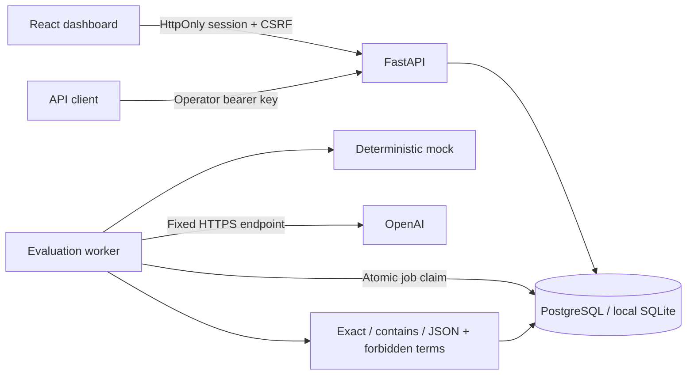

# Architecture and tradeoffs

## Durable queue without Redis
Runs are queued in the same database as their configuration. This avoids a commit/publication gap and reduces infrastructure for this separate service. PostgreSQL workers select using `FOR UPDATE SKIP LOCKED` and conditional state transition. SQLite uses a conditional update and WAL; losers poll again. Run creation serializes queue admission with a PostgreSQL advisory transaction lock or SQLite immediate transaction. This enforces at most eight active/queued runs across API processes.

Each worker processes one run and one case at a time. Scale PostgreSQL workers for throughput; SQLite is intended for a local, small instance. An application-process limiter allows ten new runs/minute and ten sign-in attempts/minute per socket peer. These counters are not distributed; production horizontal scaling needs shared rate-limiting infrastructure.

## Crashes, retries, and cancellation
A worker heartbeat is updated between cases. Runs with a heartbeat older than three minutes become interrupted. Partial results remain accessible. The service never automatically reruns an ambiguous paid generation after worker death. Operators explicitly create a new run. Unique `(run_id, position)` constraints prevent duplicate result rows. Provider HTTP transport retries connection establishment once; generation failures are not automatically replayed.

Cancellation is cooperative: queued jobs cancel immediately; running jobs stop after the current provider call returns. That call can still be billed. HTTP connect timeout is 10 seconds and read timeout 35 seconds; these are transport inactivity bounds, not a hard total deadline against a deliberately slow upstream. The fixed trusted upstream is part of the boundary.

## Reproducibility
Case arrays are canonicalized and hashed. A run stores its own dataset snapshot, so subsequent database changes cannot change its evaluation target. The model receives only the prompt and optional system instruction. Expected answers remain in the grader. Comparisons require identical fingerprints and completed runs. Version-pinned model names are preferable to aliases for real experiments.

## Metrics
Timing uses a monotonic clock around generation. Successful provider responses contribute latency samples even if assertions fail. Provider errors have elapsed time per case but are excluded from latency percentiles. Unknown token counts and costs stay nullable. Summaries flag incomplete accounting instead of silently treating failures as free. Cost estimates use run-specific operator prices per million tokens.

## Authentication
One trusted operator owns the instance. A random long access key bootstraps an eight-hour server-side session. Only its random cookie-token hash is stored, together with CSRF and the current operator-key digest. Rotating ADMIN_KEY invalidates existing sessions after process restart. Logout deletes the server session. This design deliberately avoids claiming user isolation, roles, or enterprise SSO.

## Schema changes
Alembic has a frozen initial migration, compatible with SQLite and PostgreSQL. Schema creation is a separate step; startup verifies the database is initialized. Future changes need new migrations rather than editing the initial migration or relying on `create_all` to upgrade existing databases.
